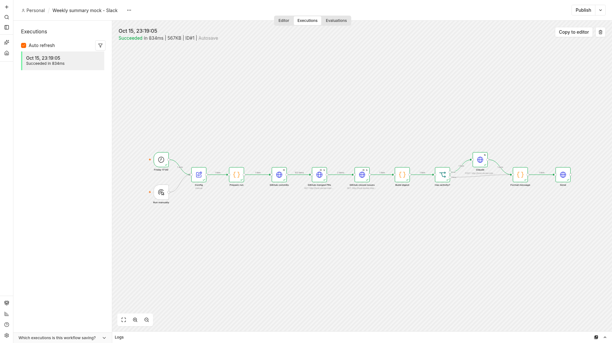

# Weekly GitHub developer summary

This n8n workflow collects a repository's default-branch commits, merged pull
requests, and closed issues for a configurable UTC lookback window. Claude
writes an English or French summary, which is delivered to Slack or Discord.
Weeks with no activity use fixed localized text and do not call Claude.

The workflow has a Manual Trigger and a Schedule Trigger set to
`0 17 * * 5` (Friday at 17:00 in the workflow timezone).

## Setup

1. Import `weekly-dev-summary.json` into n8n.
2. Create a **GitHub API** credential with repository read access and map it to
   the three GitHub HTTP Request nodes during import.
3. Create an **Anthropic** credential with an API key and map it to the Claude
   HTTP Request node.
4. Edit the Config node values below, set the workflow timezone in workflow
   settings, and run the Manual Trigger once before activating the schedule.

## Configuration

| Field | Accepted value | Default |
| --- | --- | --- |
| `github_repo` | Repository in `owner/name` form | `owner/name` |
| `delivery_platform` | `slack` or `discord` | `slack` |
| `webhook_url` | HTTPS incoming webhook URL | Placeholder; must be replaced |
| `language` | `EN` or `FR` | `EN` |
| `days_back` | Integer from 1 to 90 | `7` |
| `claude_model` | Anthropic Messages API model ID | `claude-sonnet-4-20250514` |

The credentials and webhook are placeholders in the exported workflow. No
tokens, API keys, or usable webhook URLs are included.

## Verification

Tested with the `n8nio/n8n:2.42.1` Docker image. Run the same test with:

```bash
./test/run.sh
```

The test imports a mock-specific copy of the workflow and two placeholder
credentials using `n8n import:workflow` and `n8n import:credentials`, then runs
three workflows with `n8n execute --id`: Slack with activity, Discord with
activity, and French with no activity. Its local server uses recorded public
`microsoft/vscode` fixtures and stubs Anthropic, Slack, and Discord.

The executed assertions cover second-page requests for commits and PRs;
GitHub and Anthropic authentication headers; GitHub query strings and encoded
`+00:00` offsets; the configured model and English prompt; Slack payload shape;
Discord chunk length and disabled mentions; linking only issue/PR numbers in
the current data; and the French quiet-week path skipping Claude. The
production export was also imported separately with empty credential IDs.

The included execution screenshot is from the local n8n 2.42.1 mock run. No
live Anthropic inference or third-party Slack/Discord delivery was performed.
The default model ID therefore was not verified against the live Anthropic API.



## Known limits

- The commits endpoint covers the repository's default branch only.
- GitHub search returns at most 1,000 results for a query.
- Each GitHub request is capped at 10 pages of 100 records. The digest lists at
  most 30 commits, 20 pull requests, 20 issues, and 20 commit authors, while
  totals reflect all records fetched within those caps.
- Discord messages are split at 1,900 characters. Slack receives one text
  payload, so Slack's own message-size limits still apply.
